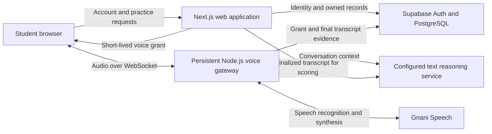

# Samvaad


Samvaad is an English voice-practice application for students preparing for interviews, vivas, debates, group discussions, and presentations. Choose a topic, difficulty, and three- or five-minute round; speak with disclosed AI participants; then review feedback grounded in the saved transcript.

## Practice and feedback

| Practice mode    | Conversation                                                                         |
| ---------------- | ------------------------------------------------------------------------------------ |
| Interview        | One AI counterpart asks for explanations and follows up on answers.                  |
| Viva             | One AI counterpart asks why, how, and what-if questions.                             |
| Debate           | One AI counterpart challenges the student's position respectfully.                   |
| Group discussion | An AI moderator and two AI peers participate alongside the student.                  |
| Presentation     | One AI counterpart listens during the protected delivery phase, then asks questions. |

The code implements five curated topics, Gentle/Standard/Intense difficulty, a microphone check, separate microphone and speaker controls, session history, and repeat practice. Each completed report contains eight dimension scores, a strongest moment, an improvement opportunity, and exactly three practice actions. The application calculates the overall score from the dimension scores.

Live availability depends on configuration and service readiness. This repository is not evidence of production acceptance. Voice sessions cannot resume after disconnection, and complete final-word capture still needs real-device acceptance. See [validation and limitations](documentation/validation.md).

Samvaad streams audio in memory and has no raw-audio recording or playback feature. It stores transcripts and feedback. Coaching evaluates text evidence; it does not measure pronunciation, emotion, or vocal confidence. External provider retention depends on the operator's accounts and agreements.

## Start locally

Use Node.js 24 and npm with the committed lockfile.

```sh
npm ci
```

Copy [.env.example](.env.example) to the ignored `.env.local` file without overwriting an existing configuration. Add the required service settings using the [configuration reference](documentation/configuration.md). The sample keeps paid voice sessions disabled.

```sh
npm run dev
```

Open [the local application](http://127.0.0.1:3013). For configured voice testing, run the separate gateway in another terminal:

```sh
npm run gateway:build
npm run gateway:start
```

Without service configuration, the public pages can be inspected, but protected practice operations remain unavailable. Follow [development setup](documentation/development.md) for database prerequisites, preview screens, and first-session checks.

## Architecture



Gnani handles speech. Groq, Gemini, or an explicitly configured compatible text service supplies dialogue and scoring. There is no automatic provider fallback. Vercel and Render deployment files describe the web application and persistent gateway separately; their presence does not establish a working deployment.

## Documentation

- [Student guide](documentation/user-guide.md): accounts, practice, feedback, and troubleshooting.
- [Documentation index](documentation/index.md): the complete user and engineering reading paths.
- [Development](documentation/development.md) and [configuration](documentation/configuration.md): local setup and environment settings.
- [Architecture](documentation/architecture.md), [API](documentation/api.md), and [database](documentation/database.md): implementation contracts and trust boundaries.
- [Operations](documentation/operations.md) and [validation](documentation/validation.md): deployment, recovery, diagnostics, and release checks.
- [Contributing](CONTRIBUTING.md) and [security](SECURITY.md): change discipline and sensitive-data handling.

## Repository checks

```sh
npm run check
npm run gateway:build
npm run build
```

`check` runs formatting checks, local documentation links, lint, strict type checking, and automated tests. Tests use synthetic content and embedded PostgreSQL. They do not certify microphones, provider accounts, hosting reliability, or student outcomes.

## Source layout

| Location              | Responsibility                                                       |
| --------------------- | -------------------------------------------------------------------- |
| `src/app`             | Website pages, HTTP routes, layout, and styles                       |
| `src/components`      | Marketing, account, practice, report, and reusable UI                |
| `src/lib/domain`      | Practice policies, transcript rules, and score validation            |
| `src/lib/client`      | Browser HTTP requests, resources, and audio transport                |
| `src/lib/server`      | Identity, owned sessions, processing, and scoring                    |
| `src/lib/voice`       | Voice protocol, provider transport, dialogue, and gateway connection |
| `gateway`             | Standalone persistent voice server                                   |
| `public`              | Microphone worklet, self-hosted fonts, and site icon                 |
| `supabase/migrations` | Ordered database definitions and operations                          |
| `scripts`, `tests`    | Configuration checks, opt-in probes, and automated verification      |

## Licensing

No repository-wide license file is included. Obtain the owner's permission before reuse or redistribution. Bundled font licenses are included alongside the [font files](public/fonts/).
