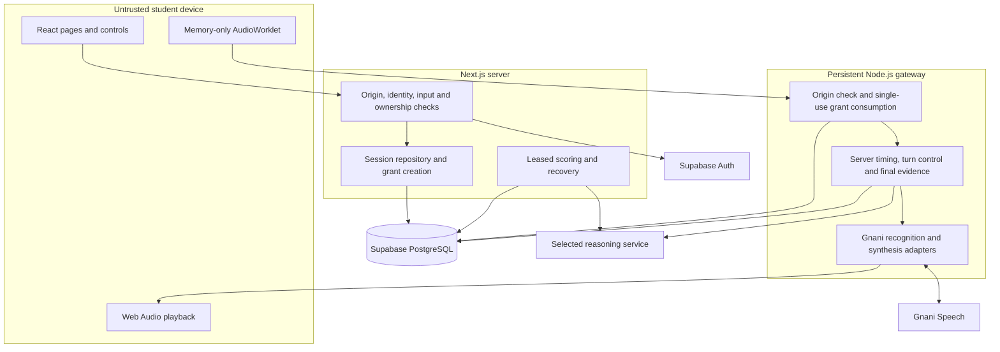
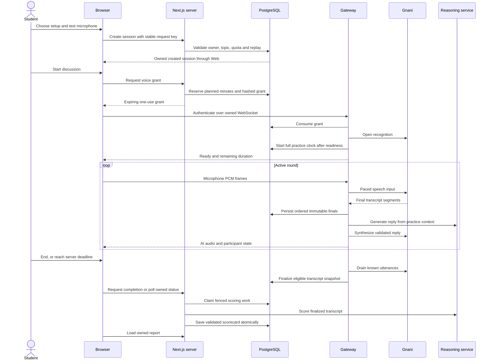
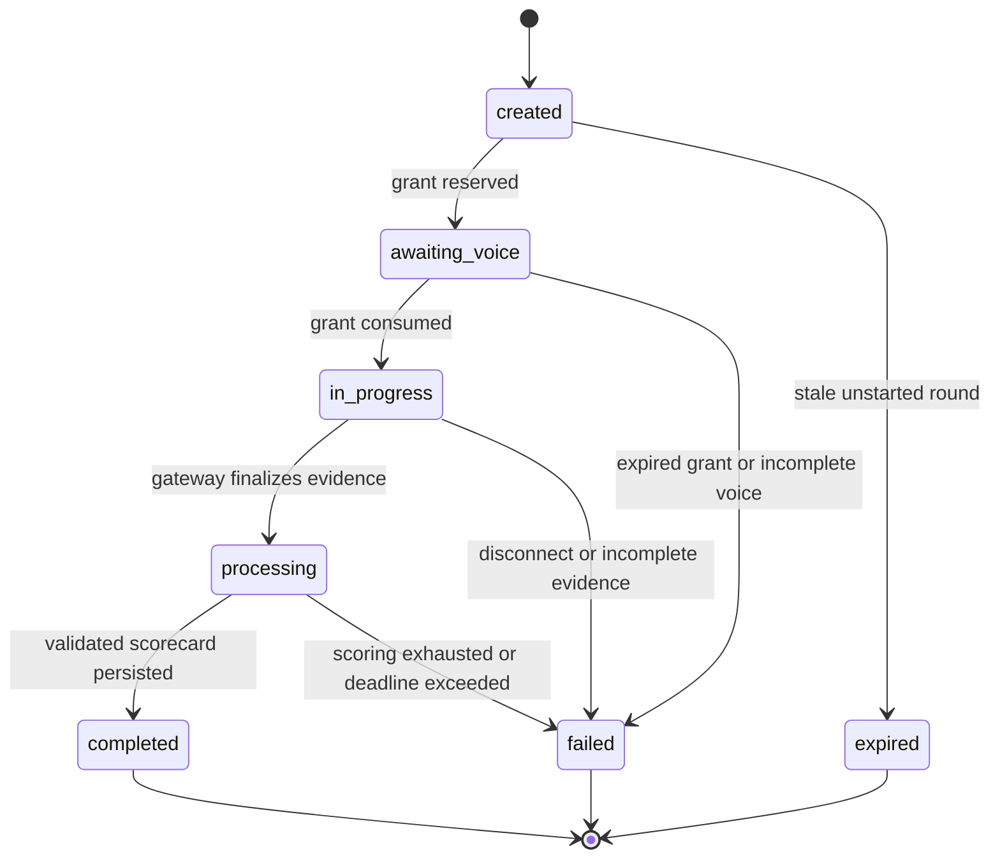

# Architecture

[Documentation](index.md) · [API](api.md) · [Database](database.md)

Samvaad has two application processes: a Next.js website/API and a persistent Node.js WebSocket gateway. Supabase supplies identity and PostgreSQL storage. Gnani supplies recognition and speech synthesis. An explicitly selected text reasoning service generates replies and feedback. The browser never receives provider credentials or directly supplies a scoring transcript.

## Components and boundaries

Cookie sessions are refreshed by `src/proxy.ts` and checked by server handlers. The privileged Supabase client bypasses browser row policies, so each application operation must bind to the authenticated owner explicitly. SQL functions implement atomic admission, deduplication, evidence finalization, and worker fencing. Origin checks supplement identity; they do not replace it.

The browser's voice grant is a random 32-byte value. Only its SHA-256 hash is stored. It expires after 60 seconds and can be consumed once. The gateway requires the exact configured origin and `/speech` path before consuming that grant. The grant remains sensitive even though it is short-lived.

## One successful round

Arrows that summarize responses through another process are conceptual. The browser accesses session data through the web API, not privileged direct database calls.

## Audio transport

The worklet averages/downsamples from the actual browser audio rate to 16 kHz mono PCM16 little-endian. It emits 512 samples in each 1,024-byte frame, representing 32 ms. It flushes a partial frame when manually ending. Audio buffers are memory-only.

The browser limits pending upload to 128 KiB. The gateway accepts exactly framed binary input, rejects sustained uploads faster than microphone time, queues at most 512 frames, and forwards at 32 ms cadence. Temporary empty input slots send silence; a prolonged lost stream fails rather than fabricating speech. Provider upload buffers and output playback also have bounds.

The gateway enforces the duration using monotonic elapsed time after recognition readiness. The database persists the corresponding start/deadline. On student speech-start, the gateway cancels the current generated/synthesized reply and clears older browser playback generations. These controls cannot prove what the student's speakers actually played or what the student heard.

No raw audio is written by the application. That statement does not establish external provider retention or training policy.

## Conversation policy

`domain/practice-mode.ts` defines the modes and rubric versions. `voice/dialogue.ts` has the transport's dialogue prompts and actor/voice mapping. The gateway enforces timing and cancellation independently of model instructions. Group discussion rotates moderator/peer roles; other modes use `coach`. Presentation blocks generated follow-ups during the first two thirds of the duration.

AI dialogue is bounded by response size, timeouts, at most two unpublished requests for eligible transient errors, total turn limits, and an audio-byte budget. The current audio budget is 35% of planned round duration at the configured PCM rate. It is a code bound, not measured participant airtime or a turn-balance guarantee.

## Evidence and scoring

Provider finals are bound to the active recognition request and segment sequence. Exact replays may succeed; conflicting identities, text changes, gaps, and immutable-turn updates fail. Empty finals remain sequence evidence but do not count as spoken transcript text. Only student finals and fully sent assistant turns enter the finalized snapshot; generated or interrupted assistant turns do not.

`known-utterances-drained-v1` means the adapter drained the utterances it knew about. It is not a provider acknowledgement that every final spoken word was captured. Final-word acceptance remains a separate live requirement.

The scorer requires a parsed two-sided transcript and at least 120 normalized student characters. It requests exactly eight unique dimensions and exactly three actions. Quoted evidence must match within one student turn after whitespace normalization; the validator rejects invented or cross-turn quotes. The application computes `round(sum(dimension scores) * 20 / 8)` and disregards a model-supplied total.

The scoring prompt prohibits vocal/emotional assessment, treats transcript instructions as untrusted content, and accounts for mode context. Output is schema-validated and rendered as text. These are enforcement measures and prompt constraints, not a guarantee that AI coaching is factually correct.

## Lifecycle and recovery

This diagram describes the current direct-speech path. The shared domain transition helper and historical database functions allow additional legacy transitions; they do not expose a public retry/resurrection endpoint for failed live runs.

Status reads and completion requests can schedule `processSession` with Next.js `after`. A separate secret-protected recovery endpoint checks at most two due sessions per invocation and expires unstarted rounds older than 30 minutes. The supplied Vercel schedule invokes recovery daily at `0 0 * * *` (UTC); it is not a continuously polling worker.

SQL grants one worker a 90-second lease token, and stale-token updates cannot finish a session. Scoring attempts are persisted before requests and limited to two. A provider failure can leave a preserved transcript with no score. A stopped gateway cannot resume its in-memory voice stream; recovery resolves stored status rather than reconstructing audio.

## Implementation references

| Concern                           | Source                                                                                                                                          |
| --------------------------------- | ----------------------------------------------------------------------------------------------------------------------------------------------- |
| Identity, origin and safe errors  | [http.ts](../src/lib/server/http.ts), [supabase.ts](../src/lib/server/supabase.ts), [proxy.ts](../src/proxy.ts)                                 |
| Owned reads and creation          | [sessions.ts](../src/lib/server/sessions.ts)                                                                                                    |
| Grants and scoring orchestration  | [workflow.ts](../src/lib/server/workflow.ts)                                                                                                    |
| Audio and WebSocket protocol      | [gnani-voice.ts](../src/lib/client/gnani-voice.ts), [worklet](../public/audio/gnani-capture.js), [protocol.ts](../src/lib/voice/protocol.ts)    |
| Gateway control and providers     | [main.ts](../gateway/main.ts), [gateway.ts](../src/lib/voice/gateway.ts), [gnani-speech.ts](../src/lib/voice/gnani-speech.ts)                   |
| Score rules and output validation | [samvaad.ts](../src/lib/domain/samvaad.ts), [scoring.ts](../src/lib/server/scoring.ts), [product-contracts.ts](../src/lib/product-contracts.ts) |

See [Operations](operations.md) for monitoring/recovery and [Validation](validation.md) for limitations that code inspection cannot resolve.
