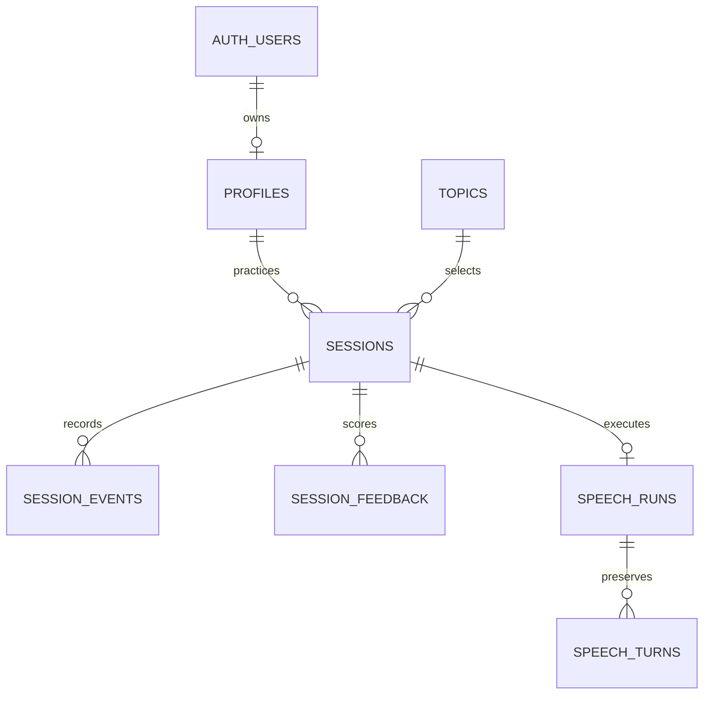

# Database

[Documentation](index.md) · [Architecture](architecture.md) · [Operations](operations.md)

The source of truth is the ordered SQL in [supabase/migrations](../supabase/migrations/). The application uses Supabase's Data API for the `samvaad` schema; it has no ORM, direct connection-string setting, or database deployment command. This document describes definitions in source, not what is installed in any remote database.

## Tables

| Table              | Responsibility and access                                                                                                                                       |
| ------------------ | --------------------------------------------------------------------------------------------------------------------------------------------------------------- |
| `profiles`         | One UUID profile per Supabase `auth.users` account. Owners can select/update their profile; created lazily by session creation.                                 |
| `topics`           | Five seeded topics with category, display order, active flag, and validation. Anonymous/authenticated readers can select active topics.                         |
| `sessions`         | Owner, setup, status, rubric, finalized transcript, report, processing leases, attempt count, and timestamps. Owners can read; trusted server operations write. |
| `session_events`   | Historical deduplicated event records; owner-readable. Current direct-speech path does not use a public webhook receiver.                                       |
| `session_feedback` | One row per session/dimension, score 1–5, reason, optional evidence quote. Owner-readable; scoring writes.                                                      |
| `speech_runs`      | One owned execution per session, hashed grant/expiry/consumption, provider request identity, deadline, heartbeat, sequence and completion status. Server-only.  |
| `speech_turns`     | Ordered final student segments and generated/sent/interrupted assistant turns. Identity `BIGINT` primary key; server-only.                                      |

Profiles/sessions use UUIDs already defined in the repository; speech turns use an always-generated identity. Instants are `TIMESTAMPTZ`. Language is constrained to `en`; difficulty and status are enums; mode/rubric combinations are checked. Foreign keys cascade account/session dependent records, while a topic referenced by a session cannot be deleted. There is no application deletion interface or retention scheduler.

## SQL sequence

| File                                                                                                | Adds or changes                                                                                                   |
| --------------------------------------------------------------------------------------------------- | ----------------------------------------------------------------------------------------------------------------- |
| [202610260001_samvaad.sql](../supabase/migrations/202610260001_samvaad.sql)                         | Core tables/types, five topics, indexes, row policies and grants                                                  |
| [202610280001_session_operations.sql](../supabase/migrations/202610280001_session_operations.sql)   | Atomic creation/replay/quota and initial history aggregate                                                        |
| [202610280002_voice_processing.sql](../supabase/migrations/202610280002_voice_processing.sql)       | Voice reservation, durable work leases, score attempts, transactional completion and historical event handling    |
| [202611080001_practice_modes.sql](../supabase/migrations/202611080001_practice_modes.sql)           | Five-mode metadata, compatible history comparisons, practice quota and legacy-preserving wrappers                 |
| [202611090001_direct_speech.sql](../supabase/migrations/202611090001_direct_speech.sql)             | Direct-speech runs/turns, single-use grants, immutable finals, snapshot finalization and speech work claims       |
| [202611090002_speech_start_clock.sql](../supabase/migrations/202611090002_speech_start_clock.sql)   | Full practice clock begins after recognition readiness                                                            |
| [202611100001_speech_empty_finals.sql](../supabase/migrations/202611100001_speech_empty_finals.sql) | Preserve empty finals as sequence evidence, reject all-silence snapshots, replay delivery acknowledgements safely |

These files include one-time object creation and alterations. Do not treat them as safe repeatable setup scripts. Later files depend on earlier function definitions. Applied historical functions/columns remain compatibility data even though the application uses the direct-speech path. Do not remove them merely because the current web API has no caller.

## Current server operations

| Function                          | Contract                                                                                                                                                         |
| --------------------------------- | ---------------------------------------------------------------------------------------------------------------------------------------------------------------- |
| `create_speech_session`           | Calls the versioned creation path; owner/key replay, mode separation, active topic and daily quota; current GD rubric is `gd-ensemble-v1`.                       |
| `reserve_speech`                  | Locks shared allowance admission, verifies owner and created state, prevents another live round, reserves planned minutes, and creates a 60-second hashed grant. |
| `consume_speech_grant`            | Atomically consumes an unexpired reserved grant and supplies trusted session context.                                                                            |
| `start_speech`                    | Binds the provider request identity once and starts the full duration after readiness; rejects stale initialization.                                             |
| `speech_event`                    | Persists heartbeats/finals/assistant delivery, drains/finalizes valid evidence, or fails a run.                                                                  |
| `request_speech_completion`       | Checks owner and requests processing attention; cannot finalize active voice evidence.                                                                           |
| `claim_speech_work`               | Fails expired/incomplete runs or claims a completed evidence snapshot with a 90-second worker token.                                                             |
| `advance_work`                    | Token-fenced attempts/retry/failure/completion; writes all feedback and computes the overall score in the completion transaction.                                |
| `practice_quota`, `history_stats` | Owner-scoped allowances and aggregates, including compatible comparison groups.                                                                                  |

Creation serializes by owner with a transaction lock. Reservation serializes the shared planned-minute budget across owners. Unique constraints bind `(user_id, creation_key)`, session/run, grant hash, student segment index/ID, and feedback dimension. These are database guarantees, not client-side duplicate-click checks.

Daily limits count creation since UTC midnight. Monthly voice allowance sums reserved planned duration since UTC month start, across all users, including failed reservations. No refund mechanism or monetary ledger is implemented.

## Evidence integrity

Student turns must be provider-final evidence with a positive contiguous segment index and provider/utterance identity. Replaying an identical final returns the prior record; changing its text or identity conflicts. A trigger prevents student evidence updates and changes to assistant identity/text. Assistant delivery may move from generated to sent or interrupted; conflicting final outcomes are rejected.

Finalization includes nonblank student finals and sent assistant turns, requires a contiguous sequence and valid drain state, and saves the snapshot on `sessions`. The code's completion marker does not certify provider final-word completeness; see [Validation](validation.md).

Database checks enforce shape, ranges, uniqueness, and some cardinality. The server's Zod/domain validators additionally enforce eight unique dimensions, three actions, quoted evidence, and consistent totals. Preserve both layers when changing scoring.

## Permissions

All seven application tables enable row-level security. Browser roles can read only the permitted active/owned records, with profile update as the limited browser write. `speech_runs` and `speech_turns` grant no browser access. Privileged functions revoke execution from `public`, `anon`, and `authenticated` and grant it to `service_role`.

Server/gateway credentials are privileged: row-level security cannot compensate for a missing owner condition in their queries. Never accept an owner from the browser. Tests exercise database roles with synthetic users; remote role configuration still requires independent verification.

## Applying changes safely

For an explicitly authorized new target, review all files in order, the Supabase auth/schema prerequisites, and the intended migration-history mechanism. On an existing target, compare installed history and object definitions before choosing pending files. Later SQL requests a five-second lock timeout; that does not guarantee zero contention or interruption.

Prepare a database backup and restoration procedure before changing stored definitions. Apply each intended change with its migration-history record in a reviewed transaction where supported. Check constraints, table permissions, function permissions, topic rows, and owned session creation afterwards. The repository contains no automatic rollback scripts. Restoring older application code does not undo SQL changes.

The embedded database tests apply the definitions without a remote account. They validate source behavior, not remote installation or production load performance.
